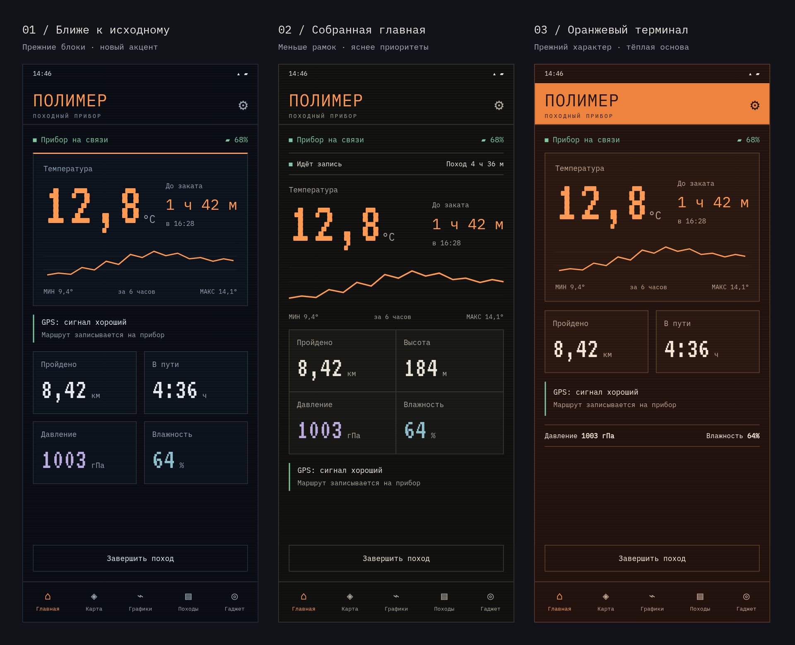

# ПОЛИМЕР: развитие текущего интерфейса

15.11.2026. Новое поручение владельца: снова подготовить несколько вариантов, **за основу взять текущий дизайн приложения, не переделывать с нуля**. Прежние макеты остаются отклонённой историей. Эти предложения ещё не выбраны.

1. [Ближе к исходному](variant-1.png): сохраняет холодную тёмную основу, рамки панелей и отдельные цвета датчиков; бренд и главный акцент оранжевые. Наиболее осторожное изменение, но оранжевый фон из исходного пожелания выражен слабее.
2. [Собранная главная](variant-2.png): нейтральный тёмный фон, общий блок температуры/заката без внешней рамки, состояние записи и длительность собраны вместе, вторичные показания — одной таблицей. Предпочтительный вариант компоновки для обсуждения.
3. [Оранжевый терминал](variant-3.png): тёплая тёмная основа, оранжевая шапка, прежний график и рамки; вторичные показатели компактнее. Ближе к пожеланию о цвете корпуса.

## Основа и границы

Проверена основная ветка f04280d, код Android 0.10.9. Theme.kt: IBM Plex Mono, VT323, углы 2dp, тёмные панели с рамками и цветами датчиков. HomeScreen.kt: StatusRow, TempHero с температурой/закатом и кривой за 6 часов, GpsCard, плитки показателей. Эти элементы сохранены в предложениях. Из существующего снимка home-saved.png изучено оформление сохранённых данных; это тестовый снимок прежней версии, не скриншот телефона владельца и не полный актуальный экран.

Числа синтетические, все три изображения показывают один активный поход с подтверждённой связью. Это статические предложения главной, не работающий APK. Удержание подтверждения END, другие состояния, адаптивность, светлая тема и остальные страницы требуют следующей проработки после выбора; старые требования 1–50 сохраняются. Отсутствие показателя на первом экране не разрешает удалить функцию. Значки здесь схематичные, окончательные — существующий набор Android. Полноценный логотип не утверждён.

[Исходник сравнения](comparison.html) использует шрифты из приложения. Снимки получены в Chromium, проверено отсутствие перекрытия содержимого нижними действиями на выбранной ширине 380px. Это не проверка Android/TalkBack/масштабирования. Код приложения, прошивка, подписи и данные не менялись. DIST1 остаётся открытым.

Ответы владельца и ограничения: [бриф](../../app-redesign-polymer.md). Основной список задач: [S6](../../software-roadmap.md). Следующий шаг — обратная связь по этим вариантам, без автоматического запуска реализации.
