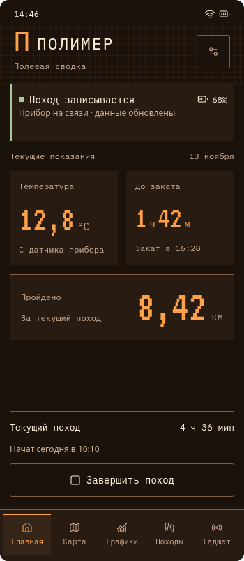
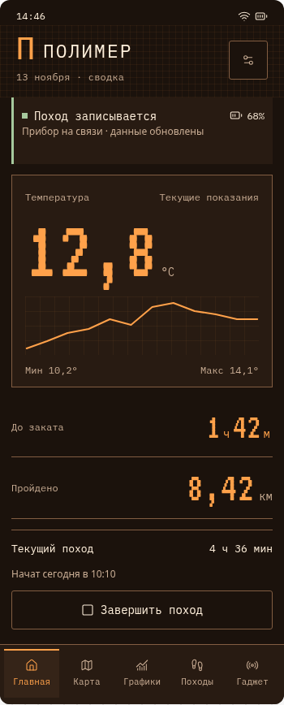
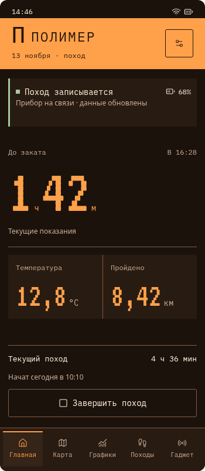
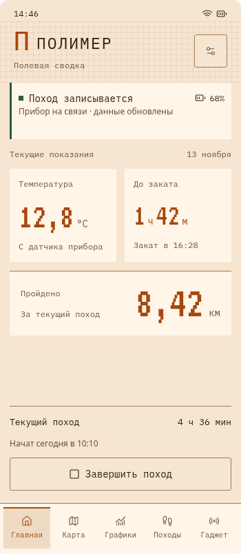
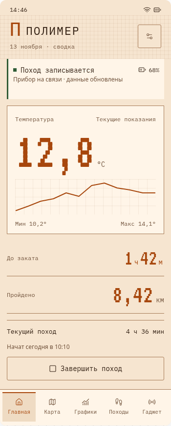
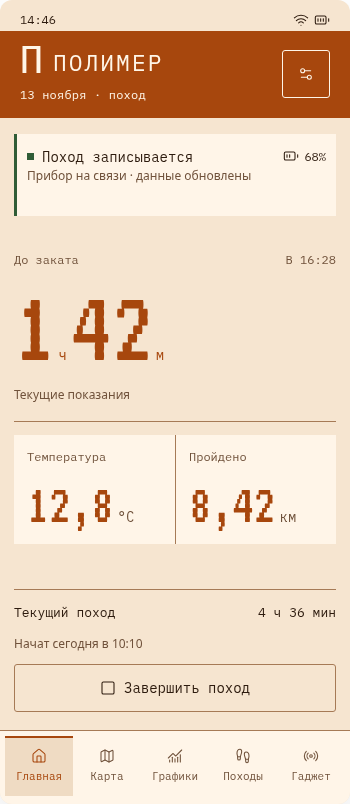

# ПОЛИМЕР: три предложения главной

## Итог: отклонено владельцем 14.11.2026

Предложенные варианты не удовлетворили владельца. **Задача подготовки подходящего
дизайна не выполнена; согласованной основы редизайна нет.** Проверки внизу касаются
технического отображения макетов и не подтверждают качество дизайна или его приёмку.
Владелец остановил работу этого исполнителя и сообщил о намерении продолжить с Claude.
Передача другому исполнителю и начало его работы не подтверждены.

Материалы ниже сохранены только как история отклонённого предложения, включая прежнюю
рекомендацию исполнителя. Не использовать их как согласованную основу и не начинать
по ним реализацию. Действующие требования — [ответы владельца 1–50](../../app-redesign-polymer.md);
опрос повторно не проводить. Android/прошивка не изменены, ошибка DIST1 не исправлена.

## История предложения от 13.11.2026

13.11.2026 · первоначально предложено; **отклонено 14.11.2026**. Основание — [ответы владельца 1–50](../../app-redesign-polymer.md),
особенно Q50 «несколько вариантов главной для начала». Сверка кода — основная ветка
`4204e76`, Android 0.10.9. На телефоне владельца установлен 0.10.6; дефекты его
экрана исполнителем не воспроизводились. Android, прошивка и APK этой задачей не менялись.

## Что выбрать

| Вариант | Иерархия | Сильная сторона / ограничение |
|---|---|---|
| **Сводка — рекомендую основой** | Состояние прибора → температура и закат → расстояние → поход | Три главных показателя легко сравнить; приборный характер спокойнее |
| **Осциллограф** | Состояние → крупная температура с кривой → закат и расстояние → поход | Выразительнее старая измерительная техника; температура занимает больше внимания, кривая частично повторяет раздел «Графики» |
| **Экспедиция** | Состояние → крупное время до заката → температура и расстояние → поход | Быстро оценить оставшийся световой день; закат получает приоритет над остальными числами |

Предлагаю «Сводку» для главной, а сетку и выразительную кривую «Осциллографа» — для
раздела графиков. Это рекомендация, не принятое решение. Заряд оставлен в блоке прибора,
длительность — рядом с походом: оба доступны без четвёртой конкурирующей большой плитки.

### Тёмная тема

Сводка:

Осциллограф:

Экспедиция:

Светлая тема: три варианта

## Что показывает прототип

[Редактируемый источник](variants.html) — фрагмент для просмотра в чате, не готовый
Android-экран и не отдельный опубликованный сайт. В нём нет связи с прибором.
Дата, 12,8 °C, 8,42 км, 4 ч 36 мин, заряд и кривая — **демонстрационные данные**.
Настройки просмотра позволяют сравнить обе темы, фон с сеткой/без неё и семь состояний:
первое подключение, готовность до START, запись, нет BLE, низкий заряд,
завершённый поход, восстановление незавершённого.

Кнопки подключения/старта/продолжения меняют только демонстрацию. Завершение открывает
подтверждение с удержанием: **1,5 секунды — предложенное время**, владелец согласовал
сам принцип, но не длительность. Короткое нажатие не завершает поход. В APK потребуется
также доступное для TalkBack подтверждение без зависимости от точности жеста.
Переходы между пятью основными разделами и значок настроек здесь обозначены визуально:
остальные страницы ещё не спроектированы.

При отсутствии BLE показаны время последних данных и «Прибор может продолжать запись»;
нет утверждения о текущей записи и кнопки END для отключённого прибора.
После END — последний поход, а не бесконечное «нет соединения» текущего похода.
После сбоя — дата последней записи и длительность, действия «Продолжить / Завершить».
[Без связи](summary-offline.png), [после завершения](summary-ended.png).

Тёмная основа тёплая коричнево-оранжевая; большая сплошная яркая заливка не используется
под текстом и числами. Светлая тема — тёплый светлый фон с более тёмным оранжевым.
Сетка только в шапке/кривой, без мерцания и помех поверх текста. IBM Plex Mono и VT323
взяты из существующих ресурсов приложения; пиксельные цифры не подменяют читаемый
текст. Шрифтовая «П» — **временный знак**, не выбранный окончательный логотип.

## Основания и аналоги

Изучены официальные рекомендации и справки, не проведено испытание живых приложений.
Аналоги помогают выбрать структуру; они не доказывают удобство именно нашего прибора.

| Источник | Что использовано / границы вывода |
|---|---|
| [Android: accessibility](https://developer.android.com/design/ui/mobile/guides/foundations/accessibility) | Ориентиры для APK: контраст текста ≥4,5:1, значимых нетекстовых элементов ≥3:1, цели нажатия ≥48 dp, масштабируемый текст и семантика. Пиксельность — в акцентах, состояние дополнительно выражено текстом |
| [Android: запрос разрешений](https://developer.android.com/training/permissions/requesting) | Первое знакомство объединяет объяснение настройки, но системные запросы идут по контексту функции/версии Android. Отказ не должен закрывать доступ к уже сохранённой истории; «все разрешения одним окном» не обещаем |
| [Komoot: навигация](https://support.komoot.com/hc/en-us/articles/10207935661338-Navigate-a-saved-route) | Карта/положение — основа экрана навигации, данные собраны в отдельной панели, остановка и завершение разделены. Поддерживает направление почти полноэкранной карты; не является основанием автоматически добавлять ведение по маршруту |
| [Komoot: статистика](https://support.komoot.com/hc/en-us/articles/10360951736858-View-and-filter-your-activity-statistics) | Завершённые активности и временная фильтрация помогают читать историю. Наши поиск/группы по месяцам/статичные миниатюры — предложение по ответу Q44, а не скопированный подтверждённый экран Komoot |
| [AllTrails: начало работы](https://support.alltrails.com/hc/en-us/articles/37200401098516-Getting-started-on-AllTrails) | Раздел Navigate сосредоточен на карте и позиции, а запись/сохранение активности имеют явные действия. Заимствуем приоритет карты, не добавляем неподдерживаемые метрики и сервисы |

Нет одного правила, однозначно выбирающего красивую компоновку. Рекомендации задают
ограничения; выбор иерархии проверяется сценариями и пользователями.

## Применение ответов к остальным страницам — пока предложение

| Возможность | Предполагаемый вход / обязательное ограничение |
|---|---|
| Подключение и цикл похода | Основное действие на главной; подробности в «Гаджете». START/END/RESUME, повторные команды и восстановление сохраняются; BLE-обрыв не завершает поход |
| Карта/слои/офлайн | Почти весь экран карты, схема и фокус на приборе; загрузка в настройках. Не выдавать устаревшее положение за текущее |
| Непроверенные GPS-точки | Информация в «Для разработчика». В обычном маршруте сохранять разрывы/ясное состояние качества, не соединять исключённый участок доверенной линией |
| Графики | Текущий поход в основной вкладке; старые внутри выбранного похода. Температура первой, существующий выбор миниатюрой сохранить; min/max рядом с кривой |
| История | Крупные блоки, поиск, месяцы, статичная миниатюра маршрута. Миниатюры кэшировать, не запускать активную карту на каждой карточке |
| Достижения | Внутренняя вкладка «Походов». Защита выбранных записей сохраняется; закрытый каталог не раскрывать |
| Настройки | Предлагаемые группы: «Прибор» / «Приложение» / «Офлайн-карты»; в группе прибора состояния, настройки и OTA. «Для разработчика» отдельной страницей через настройки. Окончательная группировка не утверждена |
| Диагностика/эмулятор | Перенести в «Для разработчика», не удалить. Краткое объяснение реальной ошибки и её код остаются видимы там, где возникла проблема; без новой кнопки «Подробнее». Перед кодом нужен аудит имеющихся ошибок, не вымышленные номера |
| Метки / хлопушка / монтаж | Q34: метки пока скрыть; Q35: хлопушку удалить; Q45: монтажный экспорт пока убрать из обычного интерфейса. Исторические записи/SYNC не стирать, прочие сигналы зуммера не отменять |

Перед кодом требуется полная матрица «старый вход → новый вход → проверка» по актуальным
экранам/командам: таблица выше не заменяет функциональную приёмку. Будущий контроль
места SD не превращается в автоматическое удаление. Успех OTA показывается только по
подтверждённому результату прибора, независимо от внешнего вида.

## Выполненные проверки и пределы

- [Отчёт просмотра](preview-checks.json): Chromium, 126 комбинаций — 3 варианта × 2 темы ×
  7 состояний × ширины внешнего окна 320/390/736 px. Нет обнаруженного горизонтального
  переполнения, выхода проверенных чисел/кнопок за блоки и ошибок JavaScript. Осмотрены изображения трёх вариантов.
- Проверены локальные действия подключения/начала/восстановления, короткое удержание,
  отмена при уходе указателя, Escape, подтверждение удержанием Enter, спокойное состояние без BLE.
- [Расчёт контраста](contrast-checks.json): основные пары текста с однотонными фонами
  дают минимум **6,98:1** в тёмной и **4,80:1** в светлой теме. Это расчёт указанных пар,
  не аудит каждого пикселя, полупрозрачного слоя или готового Android-интерфейса.

Это проверки макета. Не проверены TalkBack, увеличенный системный текст, реальный
Android edge-to-edge/клавиатура/жесты/разрешения, улица/солнце/перчатки, расход батареи,
аппаратная связь или чтение экрана владельцем. minSdk26/target35 из текущего проекта
не гарантируют одинаковую работу на всех телефонах. Нужны Infinix владельца и другие
размеры/API, светлая/тёмная тема и увеличенный текст.

**DIST1 остаётся открытым**: правильные демонстрационные 8,42 км на главной/итоге не
исправляют наблюдаемое удвоение расстояния в истории 0.10.6.

## Следующий согласуемый объём

Выбрать основу главной и степень оранжевого/пиксельности; затем согласовать план
Android. Порядок предлагается в **S6 основного [списка задач](../../software-roadmap.md)**:
матрица функций и состояния → тема/общие компоненты/главная → карта → графики/история →
настройки/диагностика/знакомство → приёмка и подписанный APK отдельной задачей.
DIST1 диагностируется отдельно, до признания итогов похода надёжными. Будущие страницы,
полный логотип и код этим предложением не запускаются.
