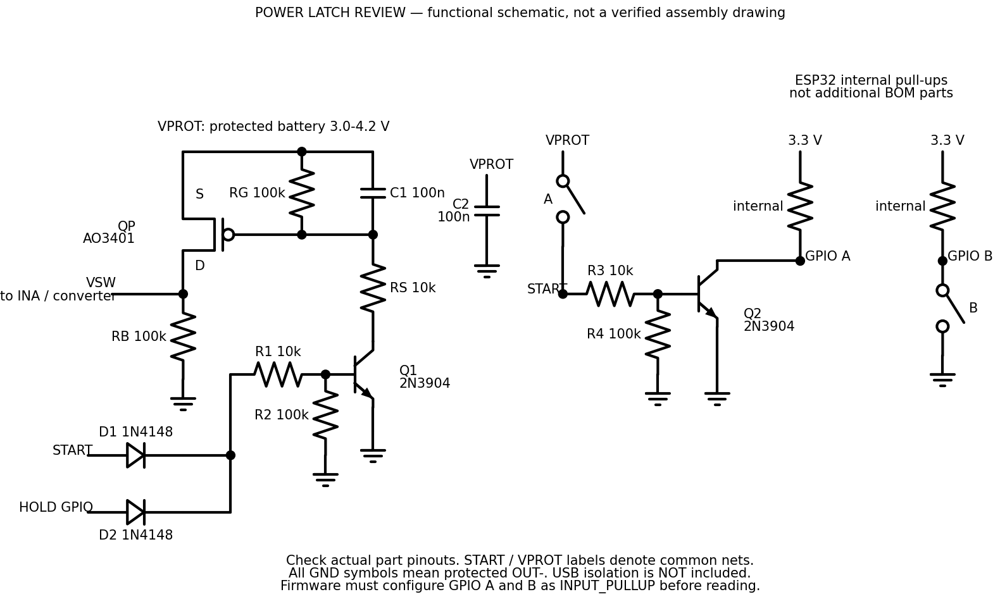
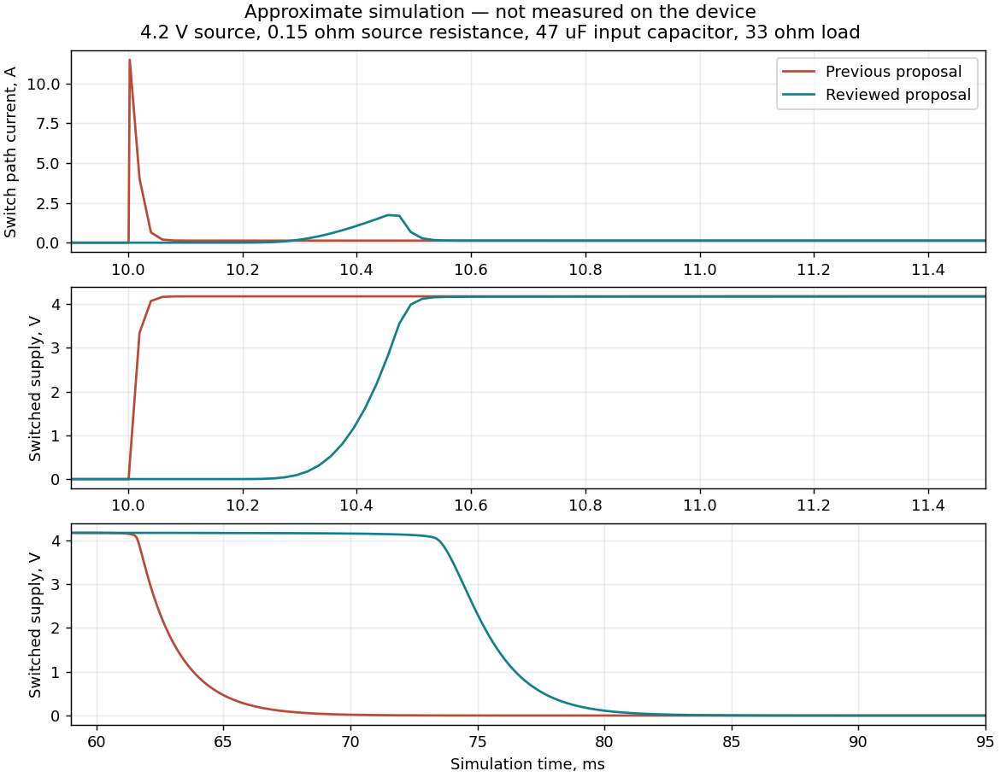

# Проверка отдельного ключа удержания питания — 10.11.2026

**Уточнение после отчёта:** владелец подтвердил наличие контакта EN на купленном
преобразователе. [Текущее предложение через EN](../button-power-selection.md)
проверяется первым; описанный здесь отдельный ключ теперь запасной. Все результаты
SPICE ниже относятся только к отдельному ключу, не к новому EN-варианту.

Статус: **инженерное предложение после расчёта и симуляции; на устройстве не проверено**.
Задача владельца — проверить сокращённую схему перед дозаказом, поискать упрощение.
Утверждён принцип `A или HOLD`, подтверждение запуска удержанием A+B, выключение
через меню с физическим отключением основной нагрузки. Номиналы ниже предложены
по результатам этой проверки. Прошивка, сборки, PCB и покупки не выполнялись.

Текущее направление и поведение: [button-power-selection.md](../button-power-selection.md).
Состав ниже сохранён для запасного варианта.
Проверена исходная редакция основной ветки `44aed41`.

## Вывод для выбора

Отдельный ключ на имеющемся AO3401 и двух 2N3904 можно оставить основой макета.
Логика запуска/удержания работает в рассмотренной модели. Предлагается сохранить
14 электронных деталей, но изменить их назначение: убрать две внешние подтяжки
кнопок, использовать внутренние ESP32; добавить резистор в цепь затвора и разрядный
резистор выхода; увеличить ёмкость gate–source до 100 нФ. Это уменьшает бросок
включения в модели и снижает остаточное напряжение при малых утечках.

После отчёта владелец сообщил о контакте EN купленного преобразователя. Теперь
предложено сначала проверить упрощение через EN. Само сообщение не подтверждает
микросхему, соединения входа или разрешение переделывать модуль.

## Какие проблемы обнаружены

| Наблюдение | Основание | Что предлагается / ограничение |
|---|---|---|
| Прямое стягивание gate QP транзистором Q1 даёт резкий заряд входных ёмкостей | Топология и сравнение переходных процессов с одинаковой условной нагрузкой | RS 10 кОм между gate и Q1, C1 100 нФ gate–source; реальные пики и нагрев всё равно измерить |
| На почти ненагруженном выходе утечка способна накопить напряжение | Отдельный тест с искусственно заданной утечкой 5 мкА | RB 100 кОм VSW–GND. Это не обещание нулевого напряжения и не подтверждённая утечка AO3401 |
| A удерживается — питание нельзя отключить программой | Аппаратное `A или HOLD`, тест stuck_a | При выключении попросить отпустить A; длительное давление продолжит расходовать батарею |
| Неверный GPIO HOLD с подтяжкой вверх способен сам включать ключ | Отрицательная контрольная проверка с 45 кОм к 3,3 В | Выбрать GPIO без стартовой подтяжки/импульса HIGH, проверить реальные boot/reset/USB; рано задать LOW |
| RESET/сброс watchdog может снять HOLD и выключить прибор | Схема; в модели сброс представлен разрывом выхода HOLD | Не обещать автоматический перезапуск. Типы сброса проверить на ESP32; обычный повторный запуск A+B |
| Один P-MOSFET не блокирует обратный ток от нагрузки к батарее | Body diode; модель с внешним источником на VSW | Проверить USB и преобразователь; до определения развязки не соединять одновременно сервисный USB ESP и батарейную цепь |
| Сигнал «запуск принят» до включения HOLD создаёт гонку с отпусканием A | Последовательность действий, а не дефект транзистора | После выдержки установить HOLD, затем показать успех/выдать последний подтверждающий сигнал |
| Экран может засветиться при пробной подаче питания от A | Вся основная нагрузка уже получает питание; управление подсветкой LCD неизвестно | Проверить купленный LCD; надпись/рисунок можно задержать программно, отсутствие вспышки подсветки пока не обещать |

Силовой ключ ставится до преобразователя и всех основных потребителей, на защищённом
выходе батарейного узла. Общая земля здесь — OUT−, не обход защиты через B−.
Сохранение SD происходит **до** снятия HOLD; конденсаторы не заменяют эту процедуру.
Потеря питания во время записи может потерять последние данные или повредить файловую
структуру. Это возможный сценарий, а не установленная причина ошибок старого прибора.

## Схема и состав



[SVG](schematic.svg), [электрический netlist](latch.cir). Это функциональные связи,
не монтажная инструкция с номерами ножек. START/VPROT на разных участках обозначают
одни и те же сети. Кольцо 1N4148 — катод; реальную распиновку транзисторов проверить
по изготовителю/маркировке. Подсветка кнопок в цепь запуска не входит.

| Изменение относительно `44aed41` | Было | Предложено |
|---|---|---|
| Q1 collector → gate QP | Напрямую | Через RS 10 кОм |
| C1 gate–source | 10 нФ | 100 нФ |
| Разряд выхода VSW | Отдельного резистора нет | RB 100 кОм на GND |
| Подтяжки A/B | По 10 кОм к коммутируемым 3,3 В | Встроенные ESP32, `INPUT_PULLUP` |
| Количество деталей | 14 | 14 |

Рабочий состав: AO3401 ×1 (уже есть), 2N3904 TO-92 ×2, 1N4148 DO-35 ×2,
10 кОм ×3, 100 кОм ×4, керамика 100 нФ ≥16 В ×2. Резисторы выводные 0,125–0,25 Вт;
для рассмотренного разброса — ±5% или лучше. Макетная плата и при необходимости
переходник SOT-23-3 считаются отдельно. Драйвер пассивного зуммера сюда не входит.

Дальнейшее сокращение имеет цену: без D1 HOLD изображает нажатую A; без D2 старт
подпитывает GPIO HOLD от батареи. Это воспроизведено замыканием каждого диода в
отрицательных контрольных опытах. Q2 отделяет батарейный START от входа ESP32.
Простой делитель вместо него не принят: надо заново решать подпитку выключенного GPIO.
Удаление разрядных/подтягивающих элементов ради числа деталей ухудшает определённость
состояний. При длинной проводке и помехах могут понадобиться внешние подтяжки A/B:
возможность их не ставить должна подтвердиться на макете.

## Что проверено расчётом и по источникам

- Для AO3401A изготовитель задаёт RDS(on) максимум 85 мОм при VGS = −2,5 В;
  напряжение порога VGS(th) не означает полного открытия. Эти данные **не подтверждают**
  марку/параметры имеющихся AO3401 без проверки суффикса и изготовителя.
- В новой цепи RS/RG затвор при включении уже не равен GND. При VPROT 3,0 В
  и оценке VCE Q1 = 0,2 В получается |VGS| ≈ (3−0,2)×100/110 = 2,55 В.
  Поэтому проверяемый диапазон — **3,0–4,2 В на VPROT под нагрузкой**. Работу ниже
  него и порог отключения разряженного прибора пока не подтверждаем.
- Для HOLD при VOH 2,64 В, падениях диода 1 В и B–E 0,85 В вход через 10 кОм
  даёт 79 мкА, из которых около 8,5 мкА уходит через R2. В установившемся состоянии
  ток RG/RS при 4,2 В порядка 38 мкА. Ёмкость и пусковые процессы проверяются отдельно.
- RB добавляет около 30–42 мкА **во включённом состоянии**. Он подключён после
  силового ключа, а не постоянно поперёк батареи; при OFF ток ограничен источниками утечки.
- ESP32-S3: внутренние подтяжки типично 45 кОм; входные пороги VIL ≤0,25VDD,
  VIH ≥0,75VDD. 30–100 кОм в модели — выбранный интервал чувствительности,
  не гарантированный изготовителем диапазон.
- В текущем [ui.cpp](../../../firmware/src/ui.cpp) A/B уже настроены как `INPUT_PULLUP`;
  [pins.h](../../../firmware/include/pins.h) использует GPIO1/2. Для нового запуска
  настройка должна происходить до первого чтения кнопок, раньше обычного UI.
- После перехода DS1302 → DS3231 GPIO7 освобождён. По поручению владельца в
  исходниках 0.1.23 он назначен HOLD (в выбранной EN-схеме — через D2).
  Это обновление программного интерфейса; прежние расчёты отдельного ключа выше
  не являются проверкой EN-схемы или поведения GPIO при boot/reset на макете.
  Со старой прошивкой DS1302 подключать HOLD к GPIO7 нельзя.

Тепловая оценка I²R для 85 мОм даёт 0,085 Вт при 1 А и 0,34 Вт при 2 А при условиях
даташита. Это не допустимый ток нашей макетной платы: важны нагрев RDS(on), медь,
пусковой импульс и работа MOSFET в линейном режиме. RS/C1 замедляют также выключение;
допустимую область работы (SOA) и температуру модель не проверяет.

## Симуляция и границы результатов

Выполнено в ngspice 44.2. [Результаты JSON](results.json), [статические случаи CSV](dc.csv),
[скрипт](run_review.py), [модели](models.lib). Все модели компонентов — собственные
инженерные приближения, **не модели изготовителя и не проверка поставленных деталей**.

- 432 статических случая: 3,0/3,6/4,2 В; −20/+25/+60 °C температуры перехода;
  BF 40/300; подтяжки 30/100 кОм; два сочетания разброса резисторов около ±5%;
  шесть сочетаний A/HOLD/внешних 3,3 В, включая ещё не запитанный GPIO.
  Это выбранные сочетания, не исчерпывающий независимый worst-case всех параметров.
- 16 переходных сценариев: обычный цикл прежней/новой схемы, отмена, зажатая A,
  HOLD в Hi-Z, дребезг A, одновременная передача A→HOLD и опоздавший HOLD,
  батарея 3 В, входная ёмкость 220 мкФ, нагрузка около 1 А, холод/малый BF,
  сопротивления источника 0,05/0,15/1 Ом, подключение батареи с/без C1.
- Отдельно: ошибочная подтяжка HOLD, отсутствие/наличие RB при заданной утечке,
  замыкание D1/D2, выключенная подтяжка GPIO A, принудительное обратное питание.
- Модель прошла заданные проверки. Минимальный |VGS| при DC ON около 2,68 В;
  LOW на A не выше 0,75% VDD, HIGH не ниже 99,9% VDD в рассмотренных случаях.
  Числа утечек из SPICE нельзя выдавать за ток хранения реального устройства.



Сравнение использует 4,2 В, сопротивление источника 0,15 Ом, входную ёмкость 47 мкФ
и резистивную нагрузку 33 Ом. Пиковый ток условного силового тракта: 11,50 А в прежней
модели и 1,91 А с RS/C1; провал VPROT соответственно до 2,47/3,91 В. При 220 мкФ новая
модель дала около 4 А. Это показывает направление изменения, **не реальные токи прибора**
и не доказательство, что 1,91 А — безопасный предел.

Преобразователь заменён грубым поведенческим источником 3,3 В, привязанным к VSW;
нагрузка резистивная. Нет модели реального TPS/XL, его UVLO/пускового тока/постоянной
мощности, boot ESP32, SD, акустики, паразитной индуктивности проводов, теплового режима,
переходов USB и точного баланса энергии. Времена команд в миллисекундах ускорены для
проверки электрической цепи и **не моделируют четырёхсекундный пользовательский жест**.
Без C1 выбранная модель подключения батареи дала лишь небольшой импульс VSW —
самозапуск в этом опыте не наблюдался. C1 нельзя объявлять доказанной защитой от любого импульса.

При искусственной утечке 5 мкА и почти отсутствующей нагрузке RB снизил VSW примерно
с 4,2 до 0,50 В. Это не оценка времени полного разряда реальной платы. При внешних
4,2 В на VSW через 1 Ом и батарее 3,3 В модель дала обратный ток около 0,20 А:
опыт доказывает отсутствие обратной блокировки у этой топологии, но не моделирует
конкретный маршрут USB через S3-Zero и преобразователь.

Воспроизведение (Python 3, установленный ngspice; прошивка не собирается):

```sh
python docs/hardware-v2/power-review/run_review.py --ngspice ngspice --output /tmp/power-review
```

Скрипт сохраняет netlist/log/полные трассы вне репозитория; они занимают порядка 150 МБ.
В git сохранены краткие результаты. Модель NPN меняет BF и IS (10⁻¹⁴/10⁻¹⁵ А),
диод — IS/N (2,5 нА/1,75 либо 10⁻¹² А/1,6); MOSFET — приблизительная VDMOS с
VTO −0,9 В, для опыта подключения −0,5 В. Остальные параметры открыты в models.lib.
Они не задают паспортные допуски AO3401/2N3904/1N4148. Цель — выявить ошибки топологии
и чувствительность, а не квалифицировать комплект для продажи.

Необязательная перерисовка графиков/схемы: Python, schemdraw 0.22 и matplotlib,
`python docs/hardware-v2/power-review/draw_review.py --output /tmp/power-review`.

## Возможность упростить через купленный преобразователь

Владелец предоставил [ссылку заказа](https://ali.click/ymrqq1m), которая перенаправляет
на [AliExpress, 1005007633450573](https://aliexpress.ru/item/1005007633450573.html).
При проверке карточка закрылась CAPTCHA; фото, выбранный SKU, фактическую микросхему,
разводку EN и ток OFF прочитать не удалось. Название XL63020 / фото TPS63020 и
выбор 3,3 В остаются сведениями из прежних скриншотов, не результатом чтения этой карточки.
Размер 26,6×18,2 мм — также прежнее заявление продавца, не замер.

У **настоящего TI TPS63020** даташит прямо указывает разрыв питания нагрузки в shutdown,
EN с порогами LOW ≤0,4 В / HIGH ≥1,2 В и запретом оставлять его неподключённым.
Есть встроенный плавный запуск. Ток самой микросхемы при EN=0, VIN=3,6 В —
0,1 мкА типично, 1 мкА максимум в указанных изготовителем условиях.
Это **не deep sleep ESP32**: питание процессора пропадает, сам преобразователь
остаётся соединён с батареей. Ток всей купленной платы может быть существенно больше
из-за LED и обвязки; год хранения и буквально нулевой расход не обещаются.

Позднее владелец подтвердил наличие контакта EN. Если вход не связан с VIN мешающей
подтяжкой/перемычкой, запуск/HOLD можно перенести на EN и отказаться от внешнего QP,
Q1 и части их обвязки. Для окончательного вывода нужны читаемые фото обеих сторон
и проверка соединений/маркировки экземпляра; наличие контакта повторно не выяснять.
Надо также проверить отключение всех нагрузок и обратное питание через USB.
Если потребуется пайка прямо к ножке корпуса 3×4 мм или разрезание дорожек без ясной
схемы, этот вариант не считаем удобным упрощением для владельца.

Автоматизированный просмотр не дал доступа к карточке. В среде remote_desktop заявлен
как enabled/state unknown, инструмента `cua_repl.js` нет; поэтому графический просмотр
не выполнен. Идентификатор среды для диагностики доступа:
`ccarenv_b64_Y2NhcmVudl84YTNjZmJjOTIzNzQ4MTkxYWFiZDJjYTljMThjZjNmMQ`.
Служебные параметры перенаправлений, cookie и CAPTCHA в репозиторий не сохранялись.

## Проверки до применения на устройстве

1. Проверить настоящие маркировки/цоколёвки AO3401 и 2N3904, контакты NO кнопки;
   проверить S/D QP — при перестановке выход может питаться через body diode.
   Собрать узел на одной паяемой плате с разгрузкой проводов. Это ещё не выполнено.
2. Сначала лабораторный источник с ограничением тока и эквивалент нагрузки:
   OFF, A, HOLD, отмена, падение питания, соединение/отпускание с дребезгом.
   Измерить VPROT, VSW, gate, GPIO; до ESP убедиться в безопасных уровнях.
3. Проверить 3,0–4,2 В и фактические пики всей V2 (ESP/BLE, SD, экран, GPS,
   зуммер), форму включения/выключения и температуру QP. По замерам уточнить RS/C1,
   доступный ток, порог разряда и ёмкости. Не выводить эти величины из одной SPICE-кривой.
4. До одновременного подключения проверить сервисный USB ESP, зарядный TP4056,
   обратную проводимость преобразователя, остаточные питающие/сигнальные цепи.
   Схема TENSTAR S3-Zero не подтверждена схемой похожей платы другого изготовителя.
5. На адаптированной прошивке: ранний LOW HOLD и INPUT_PULLUP, короткие/долгие A/B,
   отпускание одной кнопки, давление обеих, стартовый жест не создаёт поход,
   HOLD до сообщения успеха, отпускание перед меню/выключением.
6. Выключение после записи/ошибка SD, повторное включение сразу и после хранения,
   reset разных типов/зависание, отсутствие самовключения после подключения батареи;
   измерить ток OFF полного устройства, включая зарядку/защиту/RTC.

Новые программные сценарии и V2-адаптация требуют отдельной задачи владельца.
Макетная проверка обязательна перед признанием узла готовым, особенно для продажи.

## Технические источники

- [Пример удержания питания ESP32/Arduino](https://randomnerdtutorials.com/latching-power-switch-circuit-auto-power-off-circuit-esp32-esp8266-arduino/): общий принцип, не проверка нашей адаптации.
- [AOS AO3401A](https://www.aosmd.com/sites/default/files/res/datasheets/AO3401A.pdf): RDS(on), порог, корпус и ограничения.
- [onsemi 2N3904](https://www.onsemi.com/pdf/datasheet/2n3903-d.pdf): NPN, выводы и электрические параметры.
- [Vishay 1N4148](https://www.vishay.com/docs/81857/1n4148.pdf): переключающий диод DO-35.
- [Espressif ESP32-S3](https://www.espressif.com/sites/default/files/documentation/esp32-s3_datasheet_en.pdf): состояния GPIO, стартовые импульсы и DC-характеристики.
- [TI TPS63020/TPS63021](https://www.ti.com/lit/ds/symlink/tps63020.pdf): §6.5, §7.3.3; shutdown, EN и ограничение начальных токов.
