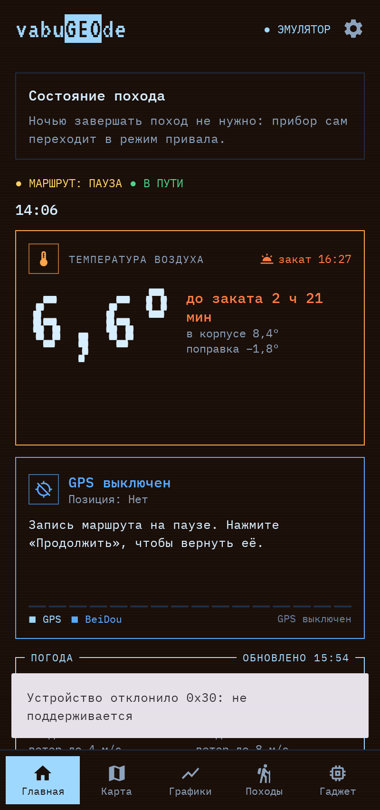

# Только замена фона, 15.11.2026

По прямому поручению владельца изменены Palette.Bg (#1A0E08), Surface (#201209), SurfaceHigh (#2B190E) в Theme.kt. Остальные цвета, шрифты, иконки, компоновка и поведение не менялись. Новые варианты дизайна не утверждены; прежние макеты отклонены.

Источник: Android Compose приложения, Robolectric API34 native graphics, 400×850dp, тест orangeBackgroundHome — прошёл. Это не HTML-макет и не снимок физического телефона. Данные эмулятора; для показа существующего блока показаний lifecycle в тесте установлен в null. На тестовом снимке есть сообщение об отклонённой эмулятором команде 0x30, не результат изменения палитры. Тест не проверяет реальный BLE и не доказывает отсутствие существующих ошибок эмулятора. Пустая кривая — отсутствие накопленной истории в тесте.

Сборка release APK не выполнялась. DIST1 не исправлен. Следующий шаг — оценка владельцем только оттенка фона.
